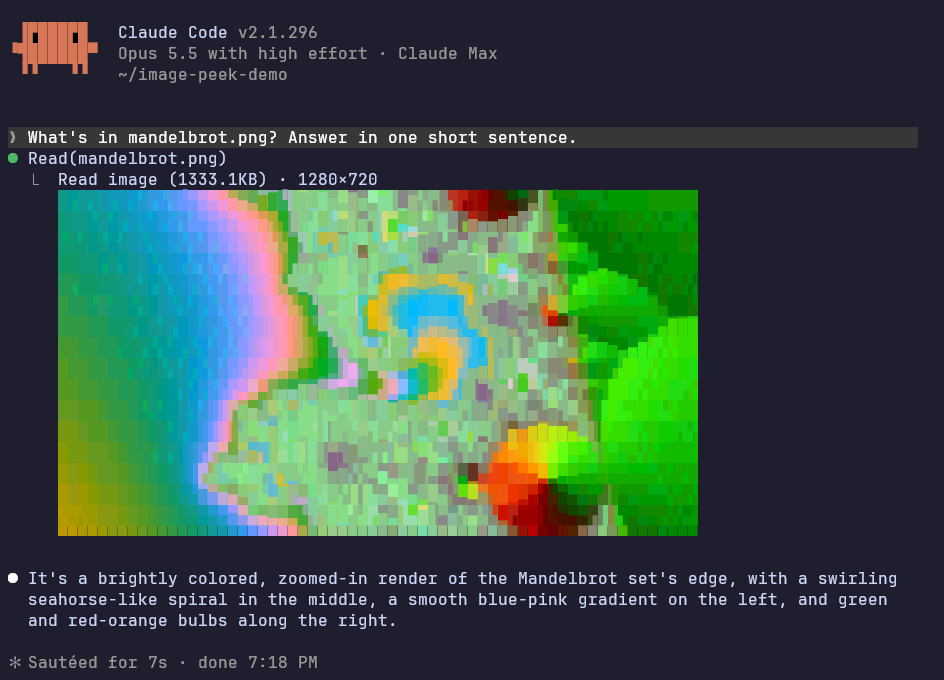

# image-peek

A Claude Code mod that draws the images Claude reads as pictures in the
terminal transcript, right under the tool call that read them. When Claude
reads a screenshot, a chart or a photo, you see what it saw without leaving
the terminal.



<sub>Windows Terminal with JetBrains Mono Nerd Font; default options except `cellAspect: 2.2` for that font.</sub>

It shows:

- **Read** on PNG, JPEG, GIF and WebP files. Claude Code hands the model a
  resized copy of a large image, and that copy is what is drawn.
- **Image blocks in any tool result**: MCP tools that return screenshots, in
  the MCP and Messages API shapes.

A run of reads folded into one line ("Read 2 files") is unfolded when it holds
an image, so each picture sits under its own call.

## Install

At the prompt of a terminal session:

```
/plugin install image-peek --marketplace thomasreichmann/image-peek
```

Answer `y` to add the marketplace, then pick a scope (user scope loads it in
every session). The mod starts drawing at once; there is nothing to restart.

## Requirements

| what | detail |
|---|---|
| Claude Code | a build with mods (2.1.287 and later). Tested on 2.1.296. The mods API is early access and can change between releases |
| where | the terminal. The desktop app's Code tab and VS Code have no cell graphics, so nothing is drawn there |
| colour | a truecolor terminal. Inside tmux, Claude Code draws 256 colours unless `CLAUDE_CODE_TMUX_TRUECOLOR=1` and `COLORTERM=truecolor` are set in the environment it starts from, and previews look coarse without them |
| decoding | nothing to install: PNG, JPEG, GIF and WebP are decoded inside the mod, in plain TypeScript |

## Options

Set them in `/config`, or in `~/.claude/settings.json`:

```json
{
  "pluginConfigs": {
    "image-peek": {
      "options": {
        "glyphs": "wedges",
        "cellAspect": 2.2,
        "background": "#1e1e2e"
      }
    }
  }
}
```

| option | default | what it does |
|---|---|---|
| `maxColumns` | `64` | widest a preview is drawn, in columns (it also stays 6 columns inside the transcript) |
| `maxRows` | `18` | tallest a preview is drawn, in rows |
| `renderer` | `cells` | `cells` picks the best glyph and two colours for every cell; `half` is plain half blocks, two pixels a cell; `image` sends real pixels with the kitty graphics protocol (kitty, Ghostty; not inside tmux) |
| `glyphs` | `blocks` | `blocks` uses Block Elements only, which every font and terminal has. `wedges` adds the Powerline diagonal wedges for smoother diagonal edges; it needs a Nerd Font or a terminal that draws Powerline glyphs itself |
| `cellAspect` | `2` | how many times taller than wide a terminal cell is, so pictures keep their shape: about 2 for Menlo, SF Mono, Cascadia and DejaVu Sans Mono, 2.2 for JetBrains Mono. If circles come out tall, raise it |
| `background` | empty | your terminal's background as `#rrggbb`. When set, picture colours within a hair of it are drawn as the terminal's own background, so a screenshot of your own terminal has no visible frame, and see-through edges blend over it. Empty, edges blend over dark grey; on a light theme, set it |

## How it draws

Each terminal cell becomes the glyph and the two colours that best reproduce
the picture under it. The picture is sampled 8 × 16 times per cell in linear
light and compared in OKLab; each candidate split of the cell (eighths,
halves, quadrants, a checker, optionally diagonal wedges) gets its two sides'
mean colours, and the split with the least error wins, against a plain cell.

Claude Code's `Raster` element rounds every colour to 4 bits a channel and
keeps at most 1024 colour pairs per element. The renderer works with that:
flat areas get their nearest representable colour, gradients get their exact
colour by mixing two representable ones inside the cell, with the remainder
diffused to the neighbours, and pictures are drawn as stacked strips of at
most 1024 cells.

A picture is decoded once (at most 768 px a side) and each box size is drawn
once (about 25 ms), so scrolling and redraws cost nothing.

The decoders are the mod's own: PNG (every colour type and bit depth,
interlaced), JPEG (baseline and progressive, greyscale, YCbCr, RGB, Adobe
CMYK), GIF, and WebP (lossy, lossless, alpha, animated). The WebP decoder
follows libwebp and gives the same pixels; its constant tables are libwebp's
(see `THIRD_PARTY_NOTICES.md`).

## What it runs, reads and stores

- **Network:** none. The mod sends nothing anywhere and fetches nothing.
- **Programs:** none. It starts no process.
- **Reads:** the image data already in the transcript's tool results, and
  the session's working directory, to shorten paths in captions. It reads no
  settings, files or environment variables.
- **Stores:** nothing. Decoded pictures are kept in memory for the session
  only, and it writes no files.

## Limits

- Images a subagent reads are not shown: their rows are not in the main
  transcript. PDF pages are not shown either.
- An animated GIF or WebP shows its first frame. JPEG EXIF orientation is not
  applied.
- Arithmetic-coded, 12-bit and lossless JPEG are not decoded (rare; the
  preview says which).
- Pictures above 16.8 megapixels are not previewed.

## Development

```sh
git clone https://github.com/thomasreichmann/image-peek
cd image-peek
claude --plugin-dir .          # a session with the mod loaded from here; edits hot-reload
claude plugin validate .       # what the engine sees: hooks, calls, problems
claude plugin test .           # the tests in tests/
```

Loading the folder once lays the API's type declarations in
`.claude-plugin/types/` (git-ignored), which `tsconfig.json` extends; after
that `tsc -p . --noEmit` type-checks the mod.

## License

MIT. The WebP tables in `hooks/webp-tables.ts` and the decoder ported from
libwebp are under libwebp's BSD 3-Clause license; see
`THIRD_PARTY_NOTICES.md`.
